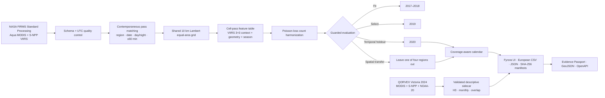

# Fyrora architecture and claim lineage

## Runtime architecture

The deployed prototype is a static, dependency-free client. Python builds reviewed tables into a compact JSON payload and copies the interface to `dist/`. The browser filters and visualizes those reviewed artifacts; it does not retrain the model, call NASA with a private key, or invent sample observations.

## Trust boundaries

| Boundary | Enforced rule |
|---|---|
| Raw acquisition | FIRMS MAP key remains in ignored `.env`; failures sanitize URLs. |
| Detection-pass comparison | Only contemporaneous pairs derived from positive detections enter calibration; this is not a full satellite acquisition mask. |
| Spatial comparison | Both sensors use the same equal-area cell. |
| Model selection | Test year cannot influence method selection. |
| Missingness | No detection-derived matched pass remains null and is rendered with a hatch; satellite non-coverage is not inferred. |
| Claims | Count is accepted; FRP is explicitly experimental. |
| Product readiness | A failed blocking outcome gate forces `operationalReady=false`. |
| Claim provenance | Every public claim has scope, limitation, an artifact path, and SHA-256. |
| Dashboard handoff | SHA-256 inventory binds 2,344 raw partitions, and the deployment manifest binds source tables to JSON and CSV artifacts. |
| Team spatial sidecar | Victoria summaries are cross-checked across files; missing days are not zero-filled and the sidecar cannot emit anomaly labels. |

## Failure modes and controls

- **Sensor discontinuity:** compare against a fixed-ratio baseline and evaluate a held-out year.
- **Temporal leakage:** split by whole years, not random rows.
- **Spatial memorization:** remove the region feature and hold out each region entirely.
- **False zeros:** carry an explicit coverage flag into the UI.
- **Aggregate metric masking:** report region × day/night subgroups.
- **Overclaiming:** label the tool as decision context, not emergency alerting or forecasting.
